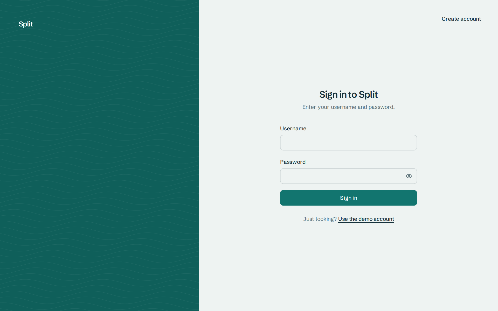

# Split

Split a restaurant bill with friends and keep track of who owes who, in Maldivian rufiyaa.

Live: https://split-website-phi.vercel.app/


<p>
  
  
  
</p>



## What it does

- **Split a bill:** enter the total and who was there, pick who paid, and split it equally or with custom amounts. The person who paid covers whatever's left.
- **Balances:** see what you're owed and what you owe, per person. Settle up (with undo) or send a reminder.
- **Friends:** search for people, send and accept friend requests. You can split with anyone on your friends list.
- **Notifications:** everyone in a split hears what they owe or are owed. Mark them read one at a time or all at once.
- **Accounts:** sign up, sign in, change your name or password, delete your account.

Works on phones and desktops, in light and dark mode.

## Try it

Every demo account uses the password `password`. Sign in as `raahil` to start with 10 friends and a friend request waiting, or tap "Use the demo account" on the sign-in page. "Reset demo data" in the Account tab puts everything back.

## Run it locally

```
npm install
npm run dev
```

Then open http://localhost:5173.

## Good to know

This is a demo: all data, including accounts, is stored in your browser's localStorage, so nothing is shared between devices. Passwords are salted and hashed, but browser storage isn't real security. Moving `src/lib/db.js` to a real backend (for example Supabase) would make it multi-device.
